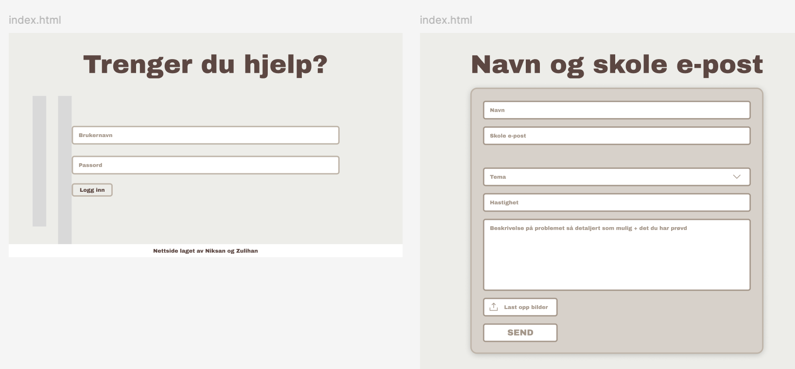

# Steg uno

- Brukeren:
  - Hva er problemet?
    kan ikke til å åpne google.com

  - Beskrivelse og tingene du har prøvd
    Har restarta pc-en og hvergang jeg skal søke noe på nettleseren sier den alltid "hmm ser ut som det er noe feil.. har du nett?"
    Jeg har sjekket at jeg har internetts kobling

  - Kategori:
    Nettverk
  - Hvor mye haster det for dere?
    Lavt - Medium - høy - NØD
    Velg basert på hvor mye den stopper GAMING opplevelsen
  - Skriv kontakt informasjon :
    Hele Navnet:

    Skole Epost:

# Steg 2

En popup som sier "sendt" eller grønn skjerm

# Steg 3

HelpDesk folk (altsa oss)

Se gjennom, de ulike tickets og rejustere og redigere ticket sitt hvor viktig det er for safety net
Vi skal også se om de har faktisk forklart deres problem og ikke bare skrevet " funegrer ikke " eller noe idiotisk som en 10åring

Og hvis det ikke er mulig å fikse så blir den enten sletta eller katogorizert som ikke

# Steg 4

Admin Brukere

      Blanding av HelpDesk folk og andre inne på 2IT hvis de ønsker å hjelpe til. De skal ha tilgang til å se en dashboard og liksom velge en oppgave/quest fra dem da. Noe de liker/ønsker å finne svar på.

      Når de er ferdig og har fikset problemet så kan de flytte den til finished.

## 5. Eksempel på gjennomløp – fra ødelagt til å spille igjen

> **Øyvind** spiller og Spillet kræsjer hver gang han åpner det.

1. **0 min** – Øyvind sender inn en ticket: _"Spillet kræsjer ved oppstart"_, kategori Programvare, prioritet Medium. Han får ticket **#1077** og en øyeblikkelig bekreftelse på e-post.
2. **5 min** – Agent Haaland leser den, ser at det har vært lignende tickets før, sjekker kunnskapsbasen og tildeler seg selv ticketen. Status: **Under arbeid**. Øyvind får et varsel gjennom teams eller discord server med en bot
3. **15 min** – Haaland trenger detaljer: "Hvilket spill, og hva sier feilmeldingen?" Status: **Venter på bruker**.
4. **20 min** – Øyvind svarer. Haaland følger løsningen : oppdater grafikkdriverne og reinstaller spillet.
5. **40 min** – Fikset. Haaland skriver hva han gjorde og merker ticketen som **Løst**. Øyvind får meldingen.
6. **45 min** – Øyvind åpner spillet, det fungerer, han sender melding at det fungerer så lukker vi ticketen
7. Haaland sin løsning lagres i databasen — neste person med samme problem får hjelp enda raskere.

**Total tid fra "det er ødelagt" til "tilbake til spilling": ca. 45 minutter, og Øyvind ble informert ved hvert enkelt steg.**

# Plan for å videre utvikle

Så mitt visjon er sånn at du kan legge noater på de "finished" tickets som de andre kan lese å fikse problmet selv, nesten som å sjekke før de sender en ticket.

En annen ting er å legge til en dashboard som alle kan se, men bare ADMINS kan redigere

Første design i figma:

### Demo av produktet

[ Se demo (spilles av når du åpner filen)](./Bilder/ProductDemo.mp4)
